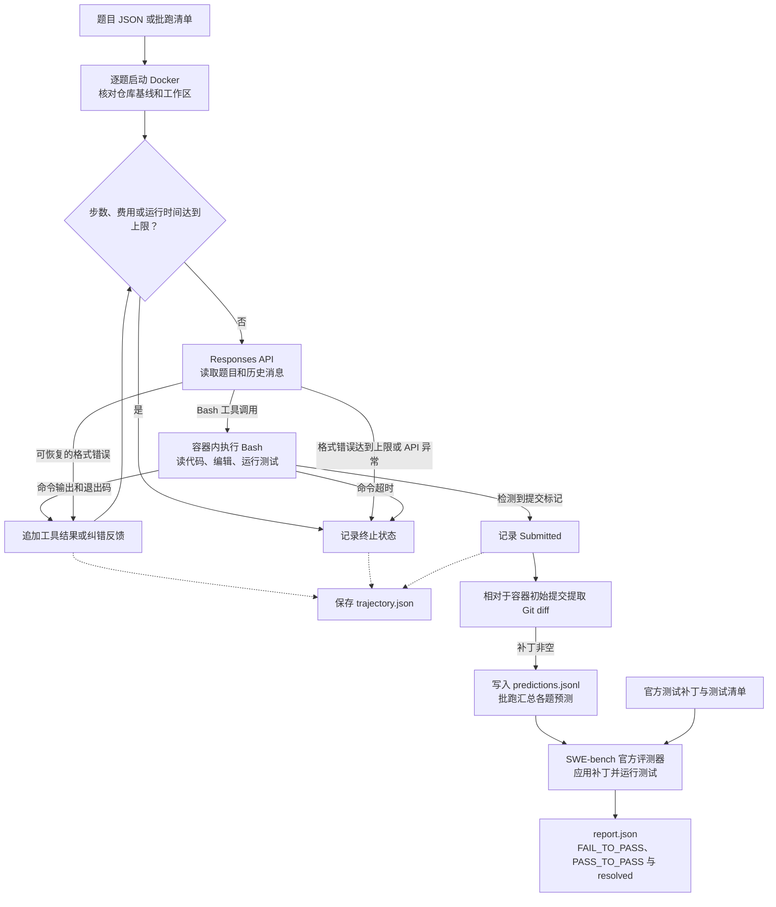

# minimal-agent

一个可运行、可复现的最小 SWE-bench Agent。它通过 OpenAI Responses API 调用模型，在每道题独立的 Docker 容器中执行 Bash 命令，保存补丁、执行轨迹和费用统计。支持单题调试、串行批跑和断点恢复，生成的预测可以直接交给 SWE-bench 官方评测器。

## SWE-bench 任务执行流程



## 安装与配置

需要 Python 3.12 或更新版本、`uv`、运行中的 Docker，以及支持 Responses API 的模型服务。SWE-bench 实例镜像使用 `linux/amd64`。Apple Silicon 上需要 Docker 支持运行 AMD64 容器。

```bash
uv sync --locked
test -e .env || cp .env.example .env
```

在 `.env` 中填写 `OPENAI_API_KEY`。使用兼容服务时，填写其 `OPENAI_BASE_URL`。在 [默认配置](minimal_agent/config/default.yaml) 中将 `model.model` 改成服务支持的模型名，并填写每百万 token 的输入、缓存输入和输出费率，单位为美元。

## 准备题目

下面从固定版本的 SWE-bench Verified `test` split 导出一份单题输入、五题批跑清单和对应的评测数据。Agent 输入只包含题目元数据与问题描述。完整记录中的参考补丁和官方测试由评测器使用。

```bash
uv run --no-project --with swebench==5.0.2 python - <<'PY'
import json
from pathlib import Path

from datasets import load_dataset

instance_ids = [
    "sympy__sympy-20590",
    "django__django-16485",
    "sphinx-doc__sphinx-11445",
    "pydata__xarray-3677",
    "scikit-learn__scikit-learn-13779",
]
dataset = load_dataset(
    "SWE-bench/SWE-bench_Verified",
    split="test",
    revision="78f471bf655a3137b2e8a75af1501690ec009ec3",
)
selected = {row["instance_id"]: row for row in dataset if row["instance_id"] in instance_ids}
rows = [selected[instance_id] for instance_id in instance_ids]
fields = ("instance_id", "repo", "base_commit", "problem_statement")
manifest = [{field: row[field] for field in fields} for row in rows]

out = Path("outputs/swebench/example-inputs")
out.mkdir(parents=True, exist_ok=True)
for name, value in {
    "instance.json": manifest[0],
    "manifest.json": manifest,
    "evaluation.json": rows,
}.items():
    (out / name).write_text(
        json.dumps(value, ensure_ascii=False, indent=2) + "\n", encoding="utf-8"
    )
PY
```

## 单题运行

```bash
uv run --locked python run_swebench_instance.py outputs/swebench/example-inputs/instance.json
```

单题入口读取默认配置，模型调用上限为 15。复现下文的 SymPy 单题基线时，运行前将配置中的 `agent.step_limit` 设为 25。脚本会打印本次运行目录，轨迹保存在该目录的 `trajectory.json`，成功提交时也会打印 `predictions.jsonl` 路径。

## 串行批跑

```bash
uv run --locked python run_swebench_batch.py \
  outputs/swebench/example-inputs/manifest.json \
  --output-dir outputs/swebench/example-batch \
  --step-limit 50
```

`--step-limit` 是每题的模型调用上限。批跑默认读取同一份 YAML，可以通过 `--config` 指定另一份配置。单题失败后批次继续执行。重新执行原命令会跳过已提交的题，并从头运行中断时还未产出预测的题。加上 `--retry-failed` 可重试此前失败的题。更换题目或配置时使用新的输出目录。

批次目录保存汇总后的 `predictions.jsonl`，以及记录配置、逐题状态、耗时、调用次数和估算费用的 `results.json`。每道题的运行目录和精简轨迹可从 `results.json` 查到。轨迹的 `usage` 保留输入、输出、总量、缓存命中和推理 token 计数。

## 官方评测

将生成的预测交给固定版本的 SWE-bench 官方评测器。以下命令把报告和日志留在批次目录内。

```bash
(
  cd outputs/swebench/example-batch || exit
  uv run --no-project --with swebench==5.0.2 python -m swebench.harness.run_evaluation \
    --dataset_name ../example-inputs/evaluation.json \
    --split test \
    --predictions_path predictions.jsonl \
    --max_workers 2 \
    --run_id verified-example
)
```

查看汇总报告里的 `resolved_instances`，或在逐题 `report.json` 中查看 `resolved`。评单题时传入脚本打印的预测文件绝对路径，并通过 `--instance_ids` 指定对应题目。参考补丁评测使用 `--predictions_path gold`。更换预测后使用新的 `--run_id`，以便评测器重新评分。[SWE-bench 官方评测指南](https://www.swebench.com/SWE-bench/guides/evaluation/)

在 Apple Silicon 上，如果单独评测时 Docker 提示找不到 ARM 镜像，用评测数据对应行的 `image` 值执行 `docker pull --platform linux/amd64 <image>`，再重试评测。

## 已验证的基线

- 单题 `sympy__sympy-20590` 使用 25 步上限，Agent 在第 17 次模型调用提交。Agent 补丁和参考补丁均得到 `resolved: true`。
- 上述五题使用 `gpt-6-sol` 和 `--step-limit 50` 串行运行。5 题均提交并完成评测，4 题通过。Sphinx 的 Agent 补丁漏了两个回归用例，参考补丁通过。5 份轨迹均已保存。
- 用同一配置重启该批次，5 道已提交的题全部跳过。
